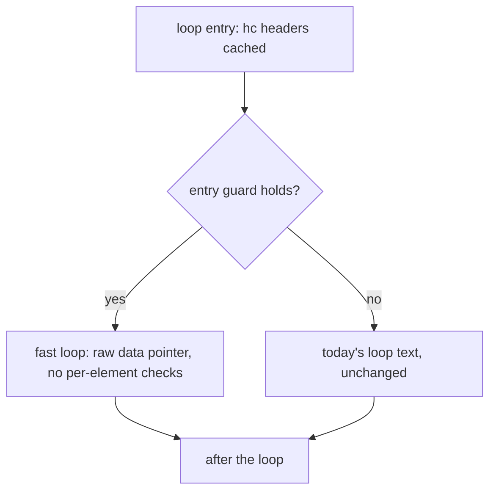

# Loop versioning for typed-array kernels — design notes

> A **working document**, not a user guarantee. It describes how numeric
> `while` loops over `IntArray` / `FloatArray` run as plain C pointer loops,
> which the host compiler then vectorizes on its own. Phase 1 below is
> implemented: loops in builds without threads or finalizers. The chunked
> form for threaded and finalizer builds (phase 2) is not. The phased
> implementation plan and the evidence behind every number and claim below
> are in
> [`.agents/plan/loop-versioning.md`](../../.agents/plan/loop-versioning.md)
> and [`.agents/plan/loop-versioning/evidence/`](../../.agents/plan/loop-versioning/evidence/).

## The problem

A loop the header cache takes (`hc_*`, `src/codegen_stmt.c`, `emit_while`)
already reads its arrays' `data` and `len` into C locals. Every element access
still pays for checks that are early exits from the loop:

- an index test against the cached length, falling back to
  `sp_FloatArray_get` / `sp_FloatArray_set` (an out-of-range read is nil in
  Ruby, not an error);
- the frozen test on a write (`_hcw`), and the header refresh after a slow
  path (`_SP_HCR`);
- `SP_FLOAT_NIL_CK` on each Float operand an analysis says can be nil (nil in
  a Float slot is the NaN `SP_FLOAT_NIL_BITS`, `lib/sp_types.h`);
- in the default `--int-overflow=raise` mode, `sp_int_add` / `sp_int_mul`
  overflow checks on the index arithmetic.

The inner loop of `benchmark/bm_matmul.rb` (`c[i*n+j] = c[i*n+j] + aik *
b[k*n+j]`) emits today as scalar code with a sentinel compare on every load
and on the product. LLVM does not even try to vectorize it: the slow-path
store `sp_FloatArray_set` is inlined, and its capacity-doubling `while` (the
`sp_pl_realloc` loop, `lib/sp_array.h`) is a loop nested inside the Ruby loop,
so the Ruby loop is not an innermost loop and the vectorizer emits no remark
for it. With that one call kept out of line, the vectorizer looks and gives
the reasons the checks imply: more than one early exit, and control flow it
cannot turn into a select. Either way the remedy is the same: a loop with no
slow path in it.

`hc_bounded_index` removes the index test only for
`i = <lit>; while i < a.length; ...; i += 1` reading `a[i]`. It does not cover
an invariant bound (`j < n`) or an offset index (`i*n + j`), and it removes
none of the other checks.

## Measured headroom

`bm_matmul` with `n = 500`, and a dot-product reduction (`s = s + x[j] *
y[j]` over 100,000 elements, 1,000 calls). Apple M2, Apple clang 21, the
flags `spinel` passes today (`-O2 -ffp-contract=off -falign-loops=64`); two
sessions of 40 interleaved runs per build, every sample recorded. The
"versioned" C was written by hand in the shape this document proposes (the
guard generated, the fast statement written per kernel); its output is
bit-identical to the current build and to CRuby. Medians, session 1 /
session 2:

| Build                                          | matmul n = 500      | dot             |
| ---------------------------------------------- | ------------------- | --------------- |
| Current emitted C                              | 222.3 / 222.2 ms    | 148.9 / 148.6 ms |
| Versioned, `-fno-vectorize -fno-slp-vectorize` | 43.4 / 43.5 ms      | 90.3 / 90.1 ms  |
| Versioned, default `-O2`                       | 21.9 / 21.9 ms      | 90.0 / 90.0 ms  |

For matmul, hoisting the checks is 5.1x and vectorization (clang: width 2,
interleave 4) a further 2.0x, 10.1x in all. No `-march`, no `restrict`: clang
emitted its own run-time overlap check between `c` and `b`. For the
reduction, hoisting is 1.65x and vectorization adds nothing (below).

### As built

The same programs compiled by `bin/spinel` with phase 1 in place, timed in
two further sessions (r1, r2) interleaved with the prototype and the current
binaries, so all four builds share each session's conditions. Medians, r1 /
r2:

| Build                                          | matmul n = 500      | dot             |
| ---------------------------------------------- | ------------------- | --------------- |
| Current emitted C                              | 231.2 / 232.7 ms    | 154.6 / 154.9 ms |
| Prototype, `-fno-vectorize -fno-slp-vectorize` | 45.3 / 45.1 ms      | 94.3 / 95.0 ms  |
| Prototype, default `-O2`                       | 23.0 / 22.9 ms      | 93.6 / 93.5 ms  |
| **Real build**                                 | **22.3 / 22.5 ms**  | **93.5 / 93.3 ms** |

The real build is 10.4x on matmul and 1.65x on the dot product, against
10.1x and 1.65x for the prototype in the same sessions: it matches the
prototype, 2–3% ahead on matmul. Its inner loops vectorize as the
prototype's do: matmul at width 2, interleave 4, and the dot product as the
same ordered reduction. It also versions `bm_matmul`'s initialisation loops
(`a[i*n+j] = ...`), which the prototype left alone, and clang vectorizes
those too. Every build ran about 4% slower than in the prototype's sessions,
the ratios did not move, and the two sessions agree to within 0.8% on every
kernel median. The machine was in use and was above the harness's idle bar
(load 2.5–2.8, 84–86% CPU idle, no process above 15%); the sessions ran on
AC power with the owner's authorization, and the evidence records it.

At `n = 150` the sessions read 4.05 / 4.03 ms for the real build against
3.43 / 3.47 ms for the prototype. That gap comes from the harness's fixed
order: the real build runs right after the 93 ms dot program. Timed
directly behind a dot run, both builds take 4.0 ms; in a neutral order,
both take 3.3 ms.

The shipped `n = 150` cannot show the split: process start-up alone is
2.6 ms, and the versioned kernel is about 0.5 ms on top of it, so the raw
times read 2.7x where the kernel is 10x, and the vectorization half is within
the start-up's own spread.

## The design: decide once, before the first iteration



The guard runs before iteration 0, so when it fails nothing has been observed
and the existing loop runs from the start with today's semantics, raises and
all. When it holds, no check the fast loop drops could have fired.

### Which loops qualify

All of these, or the loop is emitted as today:

1. The loop qualifies for the header cache (`hc_node_ok`) and contains no
   nested loop (already implied: `hc_node_ok` rejects one).
2. Induction shape, extending `hc_bounded_index`: the statement ahead of the
   loop is `j = <Integer literal >= 0>`, the predicate is `j < N`, the body's
   last statement is `j += 1` or `j = j + 1` (`bm_matmul` writes the second,
   which `hc_bounded_index` does not accept), and nothing else writes `j`
   (`subtree_changes_local`). `N` is an Int literal or an Int local the loop
   does not assign. (`a.length` / `a.size`, `hc_bounded_index`'s case, is
   not taken yet.)
3. Every typed-array access in the body (`x[e]`, `x[e] = v` on a cached
   `IntArray` / `FloatArray`) has an index of the form `j`, `B + j` or
   `j + B`, where `B` is built from Int literals, locals the loop does not
   assign, and `+` / `-` / `*`. One access of any other shape disqualifies the
   whole loop: keeping one checked access would keep an early exit. So does
   an element `x[e] op= v`, whose store site is not versioned yet, and a
   `break`, `next` or `redo`: a `next` would skip the closing increment that
   the fast loop's `j++` stands for.
4. No array in the loop is one analysis marked as holding nil
   (`nullable_int_elem_array`). `may_nil` is kept up to date only for the
   unmarked ones: a marked array's stores set no flag and its whole-array
   reads scan for the sentinel instead (`src/analyze.c`). For an unmarked
   array the run-time `SP_MAY_NIL` test below is exact; for a marked one it
   proves nothing.

### The entry guard

Emitted once, after `_SP_HCR()` has filled the cache:

- every cached array is non-null;
- every array the loop writes is not frozen (`_hcw`);
- every Float array the loop reads is nil-free at run time (`SP_MAY_NIL`, the
  same fact `hc_array_nilfree` reads); an Int array likewise when its element
  can be `SP_INT_NIL`;
- every Float local the body reads that an analysis marks nullable is not nil
  (`!sp_float_is_nil`);
- for each distinct offset `B` and its array `x`: `B` is computed with
  `__builtin_mul_overflow` / `__builtin_add_overflow`, and
  `B >= 0 && B + N <= len(x)` without overflow; with `j` starting at a
  literal `>= 0` and staying below `N`, every index is in range and no index
  arithmetic in the loop can overflow;
- `N >= 0`.

Static proofs are not an option here: in `matmul(a, b, n)` the lengths of `a`
and `b` are only known at run time. The guard is the proof.

`may_nil` is array-wide and sticky: one nil gap anywhere in an array sends
every loop over it to today's loop, every time. That is a missed speed-up,
not a wrong answer.

### The fast loop

What `bm_matmul`'s inner loop emits (the guard abridged):

```c
{
  /* hc declarations and _SP_HCR2() as today */
  { int _lvg2 = 1; sp_int _lvn2 = lv_n; if (_lvn2 < 0) _lvg2 = 0; /* ... */
    if (_lvg2) {
      for (; lv_j < _lvn2; lv_j++) {
        { sp_float _t20 = (_hcd2_0[_lvo2_0 + lv_j] + (lv_aik * _hcd2_1[_lvo2_1 + lv_j])); _hcd2_0[_lvo2_0 + lv_j] = _t20; }
      }
    } else {
      while ((lv_j < lv_n)) { /* today's text */ }
    }
  }
}
```

The guard's locals are `_lvgN` (it holds), `_lvnN` (the bound), `_lvoN_k`
(each offset `B`) and `_lvtN_t` (the overflow chain's temporaries).

- `j` stays the Ruby local, so its value after the loop is the same as today.
- Array reads and writes are raw `data[ofs + j]`. No `_hcw` test, no slow path,
  no `_SP_HCR` refresh: no write can grow an array, and nothing in the loop
  can move one (`hc_node_ok`).
- Float arithmetic drops `SP_FLOAT_NIL_CK` when every operand is a nil-free
  array read, a guarded local, a literal, or the result of such arithmetic.
  Every NaN an operation *generates* from non-NaN operands is the canonical
  `0x7FF8000000000000` on arm64 (measured: `0/0`, `inf - inf`, `0 * inf`,
  `sqrt(-1)`, `fmod(1, 0)`, `log(-1)`), never `SP_FLOAT_NIL_BITS`.
- Int arithmetic that is not index arithmetic keeps its overflow checks, and
  Int division keeps its `ZeroDivisionError`. Such a loop runs correctly but
  will not vectorize; that is acceptable.
- Float semantics are unchanged: same operations, same order, still
  `-ffp-contract=off`.

#### The crafted-NaN caveat

A NaN *operand* keeps its payload through arithmetic, so two Float values that
are not nil can still produce exactly `SP_FLOAT_NIL_BITS`: a signaling NaN
with payload 1 (`0x7FF0000000000001`, quieted by any operation) and the
sentinel with its sign bit set (`0xFFF8000000000001`, through `-x` or
`x.abs`). Measured on arm64, in scalar and in vectorized code; x86-64 quiets
signaling NaNs the same way. A program can only build such a value bit by bit
(`pack` / `unpack`, binary I/O), and today's spinel already misreads it: where
CRuby prints `NaN`, spinel reads nil and raises `TypeError`. The fast loop
moves where that existing divergence surfaces — it stores the sentinel into
the result array, where today's loop would have raised at the `*` — and does
not create it. It is the same documented compromise the sentinel already
makes (`lib/sp_types.h`: a real Float with this bit pattern reads back as
nil), widened to say that arithmetic on such a crafted NaN can yield it too.
A guard against it would scan every element; it is not worth one.

### Float reductions

A reduction (`s = s + x[j] * y[j]`) qualifies like any other loop and gets
the hoisted checks. Clang then vectorizes it too, as an *ordered* reduction:
the products go two at a time, and the sum is a chain of
`llvm.vector.reduce.fadd` without the `reassoc` flag, lowered to lane-by-lane
adds in source order. The result is bit-identical to CRuby. What keeps the
order is that spinel never passes a reassociation flag (`-ffast-math`,
`-fassociative-math`); `-ffp-contract=off` is not involved, and the result is
the same with `-ffp-contract=on`. Only reassociation changes the bits, and it
stays out.

So for a reduction the gain is the hoisting (1.65x on the dot product above);
the ordered vector form keeps one serial chain of adds and gains nothing over
the scalar loop. Making a reduction faster than that would need
reassociation, which changes the result against CRuby.

(`bm_spectral_norm` is not an example: its inner loops call the user method
`eval_a`, which the header cache refuses, so they are never cached and loop
versioning does not reach them without inlining.)

### Polls

A cached loop with `g_uses_threads` or `g_uses_finalizers` polls at the top of
its condition. The fast loop must not drop that: it runs in fixed-size chunks
(4096 iterations, to be tuned) with the same polls between chunks, and
refreshes the cache and re-checks the guard after a poll, since another
thread or a finalizer may have shrunk or frozen an array. A failed re-check
falls through to today's loop from the current `j`, which is still correct:
the iterations already done are exactly the ones today's loop would have
done.

### Bisecting it

Dropping a check whose omission would be wrong is a miscompile, and that is
what the decision registry (`src/decide.c`) exists for. Versioning a loop is
a decision of kind `loop-version`, keyed at the `while` node: `spinel bisect`
can deny it loop by loop, and a denied loop is emitted exactly as today.

## Where the code goes

- `src/codegen_stmt.c`: `HcRegion` carries the induction fact (`j`), a small
  table of `(array entry, offset expression)` uses, the guarded locals, and a
  fast-mode flag; `hc_versioned_shape` sits next to `hc_bounded_index`;
  `hc_version` emits the guard and the fast loop, and `hc_close` writes them
  ahead of today's loop inside the existing frame. The body is emitted for
  today's loop first, which fills the entry table, then again in fast mode;
  a fast emission that would add an entry, or whose text still holds a slow
  path, is dropped and the loop keeps today's form alone.
- The guard owns each offset `B`: a small emitter for the offset grammar
  writes `__builtin_*_overflow` chains into a local, and the fast access
  sites read that local rather than recompute `B`. (`emit_int_expr` cannot
  serve: its `sp_int_mul` raises on overflow where the guard must fail.)
- One predicate on the region answers "is this operand nil-free in the fast
  loop" (`hc_fast_nilfree`); asking it about a local is what puts that local's
  nil test in the guard.
- The access sites that consult the cache ask `hc_fast_access` for the raw
  access: the read in `src/codegen_call_recv.c` (the `is_element_at_alias`
  branch, ahead of `hc_index_in_range`) and the `[]=` store in
  `src/codegen_stmt.c`. `emit_nilfree_operand` stands aside in fast mode,
  since the read it would wrap is already raw. The nil checks go where they
  are decided: the binary Float operator in `src/codegen_call.c`, which emits
  the `SP_FLOAT_NIL_CK` on `c[..] + aik * b[..]`, is gated by
  `cmp_operand_may_be_nil`, and `emit_scalar_op_assign` by its own operand
  test; both ask `hc_fast_nilfree`.
- No analysis change and no new pass. The decision needs state that exists
  only while `emit_while` runs: the cache's entry table is filled lazily, by
  the access sites, as the body is emitted (`hc_array` → `hc_entry`), and each
  entry's receiver is C text rendered there through `emit_expr`
  (`hc_recv_text`). The guard has to name those entries. (The statement ahead
  of the loop, `g_stmt_prev`, is an AST fact a pass could compute; it is not
  the reason.)

## Phases

1. **Single-threaded fast loop** (implemented): the shape, guard and fast loop above, only
   when neither `g_uses_threads` nor `g_uses_finalizers` is set, with
   fixtures pinning today's behaviour where the guard must fail (a nil
   element, a short array, a frozen array, one array under two names, an
   `i*n` that overflows under `--int-overflow=raise`).
2. **Chunked fast loop** for threaded and finalizer builds: the poll rules
   above.
3. **Measure, then decide on more**: record which loops qualify
   (`spinel-doctor`'s `advice` leg is the natural place to say why one did
   not), and widen the index shapes only where a measured kernel needs it.

The steps, files and gates of each phase are in the plan.

## Out of scope

- **Reassociating Float reductions.** It is the only thing that would make a
  reduction's vector form faster, and it changes the result against CRuby.
- **Hand-written SIMD intrinsics.** The host vectorizer handles the shape
  above; intrinsics are only worth revisiting for a kernel it measurably
  cannot.
- **`restrict`.** Ruby callers may pass one array under two names; a wrong
  `restrict` is undefined behaviour, and the vectorizer's own run-time overlap
  check already covers the case.
- **`-march` / tuning flags.** NEON is the arm64 baseline already; on x86-64
  they only widen the vectors at the cost of a portable binary. At most a
  later opt-in.

## Rejected alternatives

- **A separate SIMD-region pass after `repr_seal`.** The cache's entries and
  their receiver text exist only during emission; a pass would re-derive both
  and duplicate `hc_node_ok`, for a fact `emit_while` can compute in place.
- **A dedicated emitter for the fast body.** It would duplicate Ruby's
  arithmetic semantics (Int/Float coercion, overflow helpers, floored
  division). The fast body goes through the normal emitters, with the region
  in fast mode.
- **A fast-loop flag tested at each access site separately.** Each site would
  own the fact "this operand is nil-free here"; one region predicate owns it
  instead.
- **Static bounds and nil proofs.** Parameters' lengths and contents are not
  known at compile time; the analysis already marks these elements nullable.
  Run-time guards decide the same question exactly.
- **Rewriting the C text after emission.** No AST or type facts at that point.
